<div align="center">

# 👥 CrowdSense

### Early warning for crowd-crush risk and queue delays, using the CCTV cameras a venue already has.

[](https://github.com/Nimbus67-tech/crowdsense/actions)


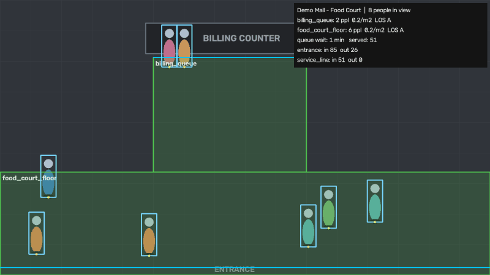

<sub>A simulated lunch rush drawn through CrowdSense's real overlay. Zones turn from green to red as density rises, and the panel shows live metrics and active alerts.</sub>

</div>

---

## Try it in 3 commands (no camera, no GPU)

```bash
git clone https://github.com/Nimbus67-tech/crowdsense.git && cd crowdsense
pip install -e ".[dashboard]"
python -m crowdsense app
```

Your browser opens the web app on a simulated 90-minute lunch rush. Drag the time slider and watch the queue build, the wait estimate climb and the alerts escalate.

## What it does

CrowdSense turns a camera feed into things a duty manager can act on:

> 🔴 **CRITICAL: Crowd density 5.3 people/m² (level F).** 👉 *Stop all inflow now, open every exit, call security and first aid.*
>
> 🟠 **WARNING: Estimated wait 19 min with 42 people queuing.** 👉 *Open one more counter and announce the expected wait.*

It runs on a laptop and never stores faces or identities.

## A tour of the app

No command line needed once it is running.

### 📈 Overview: one glance, one decision
A colour-coded banner says what is wrong and **what to do**. KPI cards show people, density (with safety level), estimated wait and service rate. A **time scrubber** replays any moment.

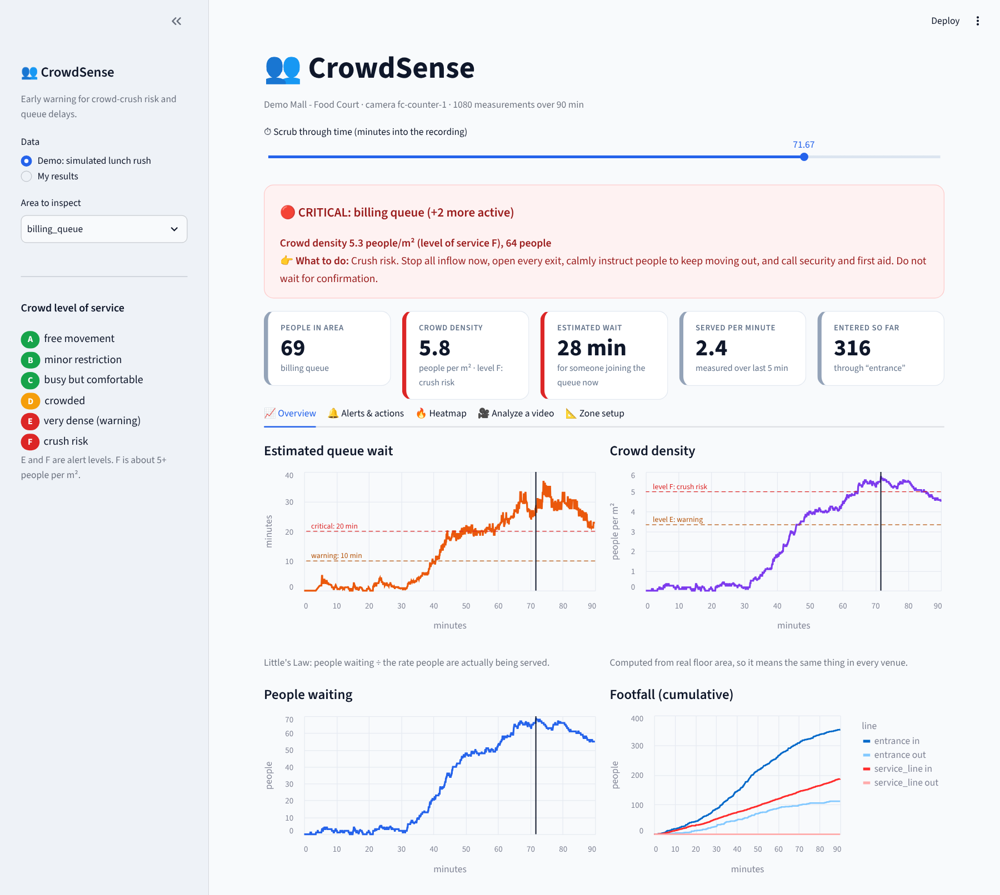

### 🔔 Alerts & actions
Every alert is debounced (no spam) and carries a plain-language instruction. Export to CSV, or push to Slack/Teams.

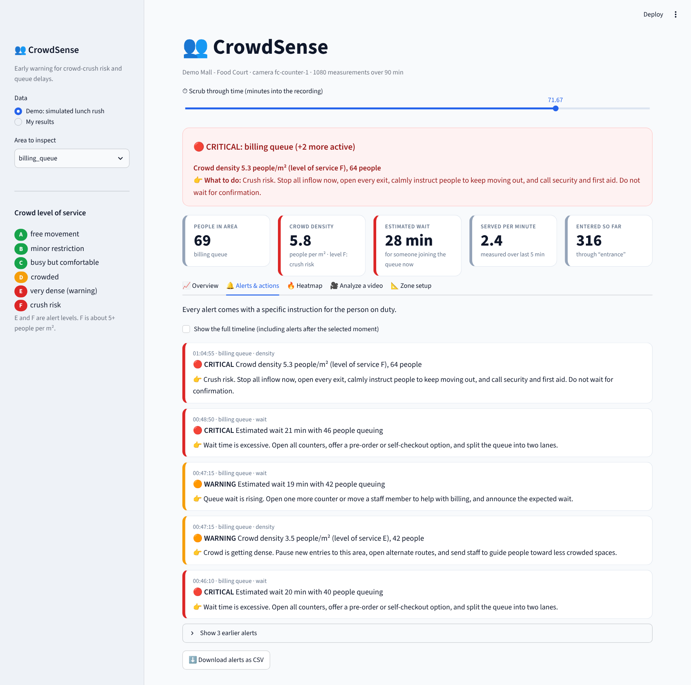

### 🔥 Heatmap
Where people actually stand and queue: useful for placing counters, signage and staff.

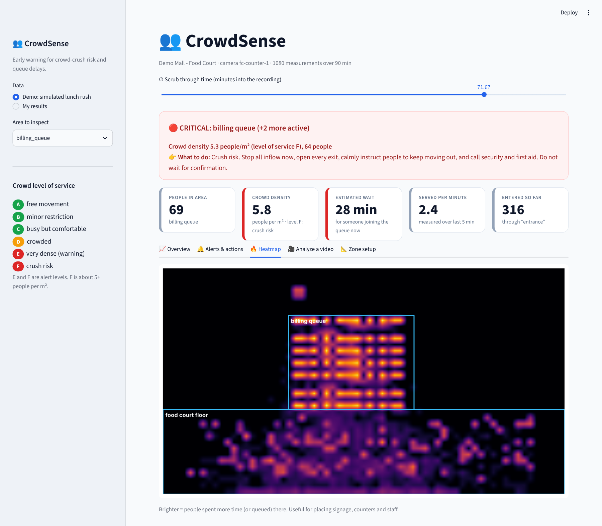

### 📐 Zone setup
Check your zones against a real camera frame **before** trusting any numbers. A pixel grid helps you read off coordinates, and arrows show which direction counts as "in".

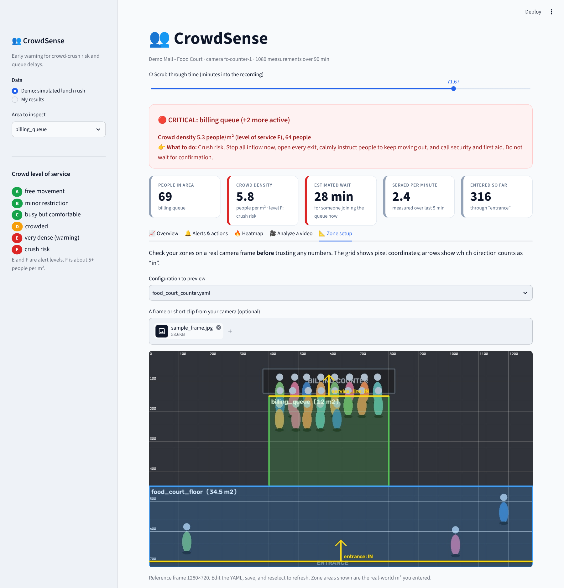

### 🎥 Analyze a video
Upload a clip, pick a venue config, press Analyze. It runs locally; nothing leaves your machine.

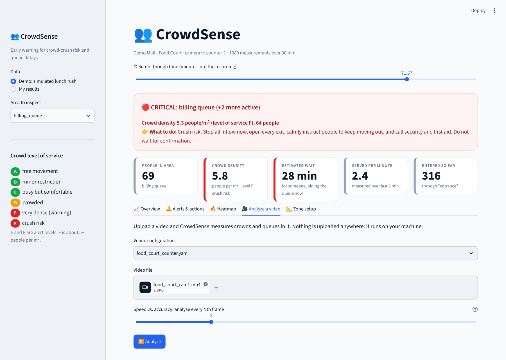

> 📸 All screenshots are of the real app running on the built-in **simulated** venue. People are stick figures because the demo needs no real footage. See [Evaluation](#evaluation) for how to validate on your own camera.

## What the live view looks like

The same overlay runs on real video. Zones are tinted by safety level (green → red), people are boxed, and a panel shows live metrics and active alerts.

| Calm (14 min) | Busy (52 min) | Peak rush (62 min) |
|:--:|:--:|:--:|
| 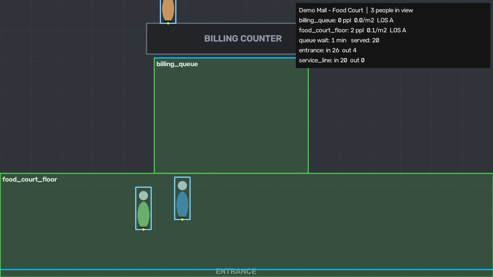 | 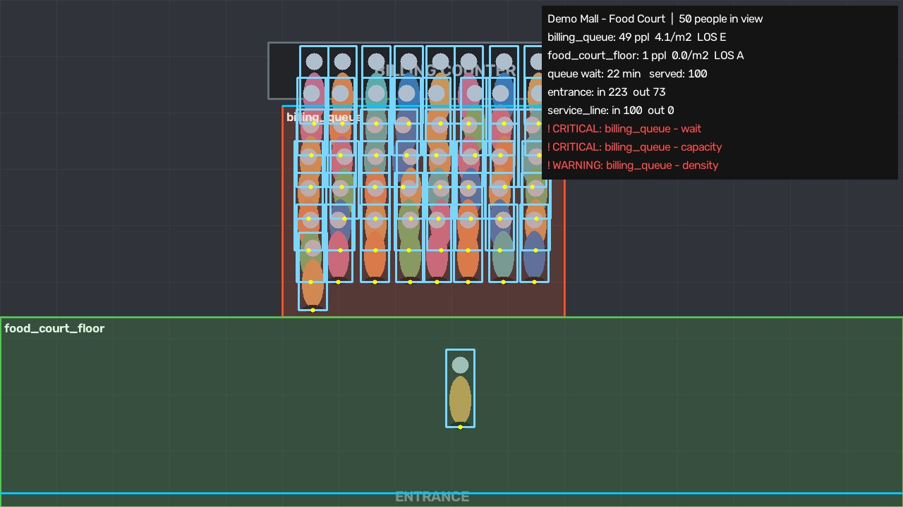 | 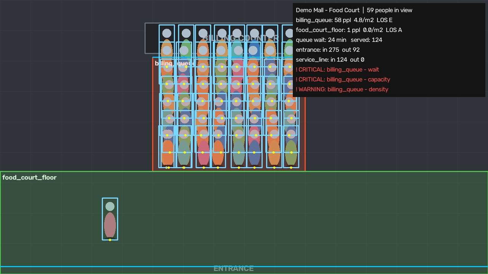 |

## The problem

- **Crowds become dangerous quietly.** In crowd-crush disasters such as Seoul's Itaewon (2022), dangerous density built up over minutes while nobody had a number to look at. Around 5 people per m², movement is dominated by the crowd and injuries become likely. A camera can measure that; a person glancing at a screen cannot.
- **Long queues cost people time and businesses customers.** "The line looks long" is not actionable. "The wait is 14 minutes and the counter served 2 people per minute over the last 5 minutes" is.
- **Existing tools** are either expensive proprietary systems or research demos that output a head count and stop. CrowdSense is open, small, and ends in a *decision*, not a number.

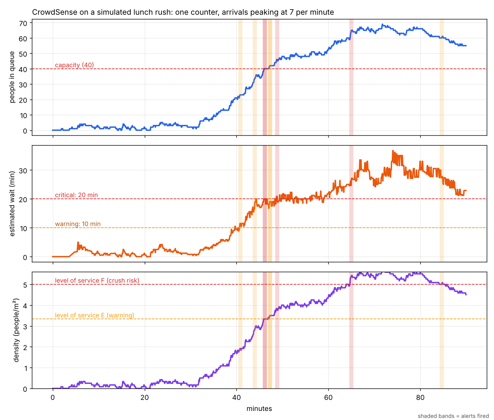

## What it measures

| Metric | What it tells the operator | How it is computed |
|---|---|---|
| **Occupancy** | People in an area right now | Foot point of each tracked person inside a polygon |
| **Density** (people/m²) | Is it crowded? | Occupancy ÷ real floor area (`area_m2`, measured on site) |
| **Level of Service A–F** | Is it *safe*? | Fruin-style thresholds on m² per person. E = warning, F = crush risk |
| **Estimated queue wait** | How long will the next person wait? | Little's Law: queue length ÷ **measured** service rate |
| **Service throughput** | Is the counter keeping up? | People crossing the service line in the last 5 min |
| **Stalled queue** | Is the counter down? | People waiting, nobody served for 2 min |
| **Footfall in/out** | How many came and went? | Directional tripwire crossings |
| **Dwell time** (mean, P90) | How long do people stay? | Time each track spends inside a zone |
| **Heatmap** | Where do people actually go? | Accumulated foot positions |
| **Capacity ratio** | Are we over the limit? | Occupancy ÷ configured capacity |

Formulas and caveats: [docs/METRICS.md](docs/METRICS.md).

## Alerts say what to do

Each alert must persist 10 s to fire and be absent 30 s to clear, so operators get one message per event, not one per frame.

| Condition | Level | Recommended action shown to the operator |
|---|---|---|
| Density level E | 🟠 Warning | Pause new entries, open alternate routes, send staff to guide people |
| Density level F | 🔴 **Critical** | Stop all inflow, open every exit, call security and first aid |
| Wait ≥ 10 min | 🟠 Warning | Open one more counter, announce the expected wait |
| Wait ≥ 20 min | 🔴 **Critical** | Open all counters, offer pre-order/self-checkout, split into two lanes |
| Queue stalled | 🟠 Warning | Check the counter: staff away? POS or network down? |
| Capacity ≥ 80% / 100% | 🟠 / 🔴 | One-in-one-out / stop entry |

Alerts go to the app, a JSONL log, the console, and optionally a Slack/Teams webhook.

## Run it on real video

**In the app:** open the *Analyze a video* tab. **Or from the command line:**

```bash
pip install -e ".[vision,dashboard]"

python -m crowdsense run --source mall_counter.mp4 \
    --config configs/food_court_counter.yaml --out runs/mall --save-video --show

python -m crowdsense app --db runs/mall/metrics.db
```

`--source` accepts a file, a webcam index (`0`) or an RTSP URL. Detection is YOLO (person class only) with ByteTrack, via Ultralytics.

### Set it up for your venue (about 30 minutes)

1. Grab a frame from the camera and note its resolution.
2. Copy `configs/food_court_counter.yaml`. Draw each **zone** as a polygon in pixel coordinates (use the *Zone setup* tab's grid).
3. **Measure each zone's real floor area with a tape and enter it as `area_m2`.** This is the most important number: it is what makes density meaningful.
4. Add **lines** at doors and counters, with an `in_direction` vector (`[0, -1]` = moving up the image counts as "in").
5. Link a queue to its zone and service line. Set thresholds.
6. Validate against a human count (see [Evaluation](#evaluation)) **before** trusting the alerts.

Camera tips: mount high and angled down (3 to 6 m), avoid shooting along the length of a queue (people hide each other), and keep the zone in the sharp, well-lit part of the image.

## How it works

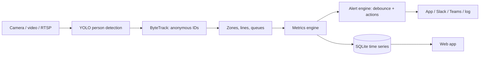

The metrics engine (`analytics.py`, `alerts.py`, `pipeline.py`) has **no dependency on a camera or model**. It consumes `Track(id, box)` objects, which is why it is fully unit-tested and why you can swap in a different detector.

```
crowdsense/
  analytics.py   density, LOS, dwell, footfall, queue wait, heatmap
  alerts.py      debounced rules + operator actions + sinks
  pipeline.py    tracks in -> metrics, alerts, storage out
  detector.py    YOLO + ByteTrack wrapper (the only model-specific file)
  runner.py      video/stream processing, shared by CLI and app
  simulate.py    synthetic venue for demos and integration tests
  evaluate.py    error metrics against human-counted ground truth
  dashboard.py   the web app
```

## Evaluation

I do **not** claim an accuracy number, because accuracy depends on your camera angle, lighting and crowd density, and a number measured on someone else's footage would mislead you. Measure it on yours:

```bash
# truth.csv:  ts,zone,count     (count people by eye at 20 to 30 moments in the video)
python -m crowdsense evaluate --db runs/mall/metrics.db --truth truth.csv
```

Reports MAE, RMSE, bias (over- or under-counting), MAPE, and the share of snapshots within ±1 person and ±10%. See [docs/EVALUATION.md](docs/EVALUATION.md).

**What is tested today:** 38 unit and integration tests cover the geometry, every metric (including Little's Law against hand-calculated values and the minimum-data rules), alert debouncing, the full pipeline, determinism, the evaluation maths, and the real OpenCV video path (with a stand-in detector on a synthetic video of known counts). The web app was smoke-tested in a real browser. **Not yet done:** benchmarking the YOLO path on real crowd footage. That is the most valuable contribution you could make (see below).

## Limitations (read before deploying)

- **Detectors undercount in dense crowds**, exactly the regime where it matters. Above roughly 4 people/m² people occlude each other and a box-detector will read low. Treat density near the F threshold as a *lower bound*, and consider a density-map model for packed scenes (on the roadmap).
- **Little's Law assumes a roughly steady state.** During a sudden surge the wait estimate lags reality. It reports "unknown" until at least 3 people have been served rather than guessing.
- **Tripwires miss people who first appear beyond the line**, and ID switches can inflate counts and shorten dwell times. Place lines where people are visible on both sides.
- One camera view = one scene. There is no cross-camera tracking.
- Density thresholds follow common planning conventions (after Fruin), not a legal standard. Align them with your local fire and safety code.
- This is a monitoring aid, **not a safety-certified system**. It should never be the only safeguard for a life-safety decision.

## Privacy by design

No face recognition, no re-identification, no frames stored. Only anonymous box geometry is processed in memory, and only aggregate numbers (counts, densities, times) are written to disk. See [docs/PRIVACY.md](docs/PRIVACY.md) for deployment guidance, including signage and data-protection law (for example India's DPDP Act 2023, GDPR).

## Roadmap

- [ ] Benchmark on public crowd datasets and publish results (MOT20, CrowdHuman, ShanghaiTech, NWPU-Crowd)
- [ ] Density-map backend for packed scenes (DM-Count / P2PNet style)
- [ ] Click-to-draw zones and click-to-calibrate homography in the app
- [ ] Multi-counter queues and multi-camera sites
- [ ] Short-horizon forecast: "wait will exceed 15 min in ~10 min"
- [ ] Telegram / WhatsApp alerts
- [ ] Docker image and a Raspberry Pi / Jetson guide

## Contributing

Good first contributions: run it on your own footage and open an issue with your evaluation results, add a venue config (airport security, temple queue, railway platform, stadium gate), or pick a roadmap item. See [CONTRIBUTING.md](CONTRIBUTING.md).

```bash
pip install -e ".[dev]" && pytest
```

Regenerate the README images yourself: `python scripts/render_scene.py && python scripts/screenshots.py` (the second needs `pip install playwright && playwright install chromium`).

## License

MIT. Built by Yogesh Kumar Mourya.
